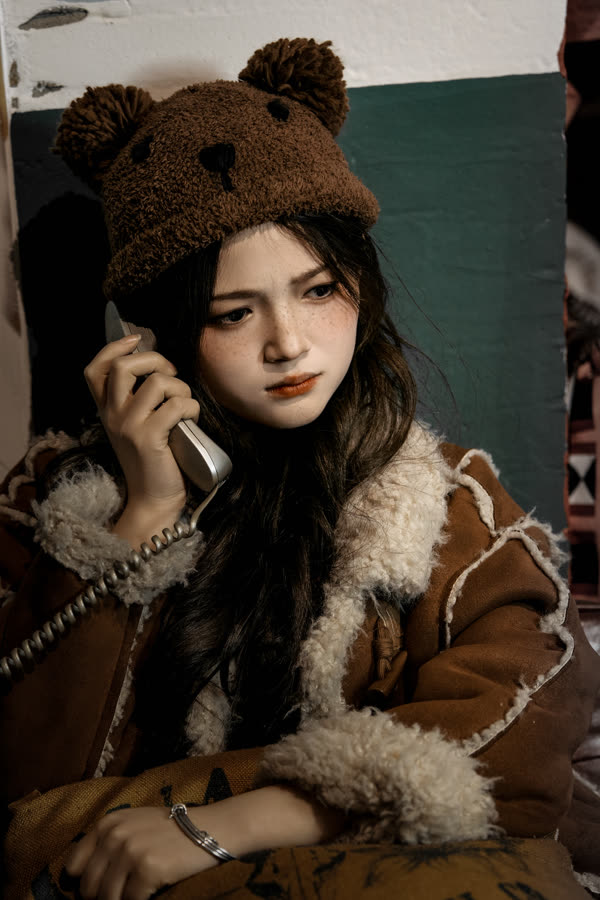

<!-- 小熊帽 · 文案 -->
> 改这一卷的文字：卷名、简介、正文，每张图的标题（## 那一行）和故事（图片下面那一段，可以不写）。
> 【待审】表示还是代拟稿——写好或确认过，就把【待审】删掉。图片那一行不用动。
> 改完运行 node tools/build-series.mjs，再打开 proof.html 校对。

卷名：小熊帽
简介【待审】：一顶小熊帽，一台旧相机，一个下午。
正文【待审】：
房间里有老电视、旧电话和一扇很大的窗。她戴着小熊帽，一会儿学着打电话，一会儿举起相机对着我。

那天光线很暗，感光度开到了一千多。颗粒也留了下来，像那个下午本来的样子。

---

## 01 坐在地上【待审】

## 02 比划【待审】

## 03 举起相机【待审】

## 04 伸手【待审】

她把手伸向镜头，羊羔毛的袖口在光里毛茸茸的。

## 05 打电话【待审】

旧电话的听筒还连着卷线。她学着打电话，说了句什么，我没听清。
