<!-- 巷子里 · 文案 -->
> 改这一卷的文字：卷名、简介、正文，每张图的标题（## 那一行）和故事（图片下面那一段，可以不写）。
> 【待审】表示还是代拟稿——写好或确认过，就把【待审】删掉。图片那一行不用动。
> 改完运行 node tools/build-series.mjs，再打开 proof.html 校对。

卷名：巷子里
简介【待审】：二月的一个下午，在巷子里走了三个小时。
正文【待审】：
古着店、贴满瓷片的门、写着粉笔字的黑板——我们走走停停，遇到好看的墙就停下来。

那天的光很硬，影子很短。我想记住的，大概就是这样一个普通的冬天下午。

---

## 01 古着店【待审】

古着店门口挂满了粉色的花，她把手搭在卷帘门上，像在等店开门。

## 02 古着店 · 二【待审】

## 03 瓷片门【待审】
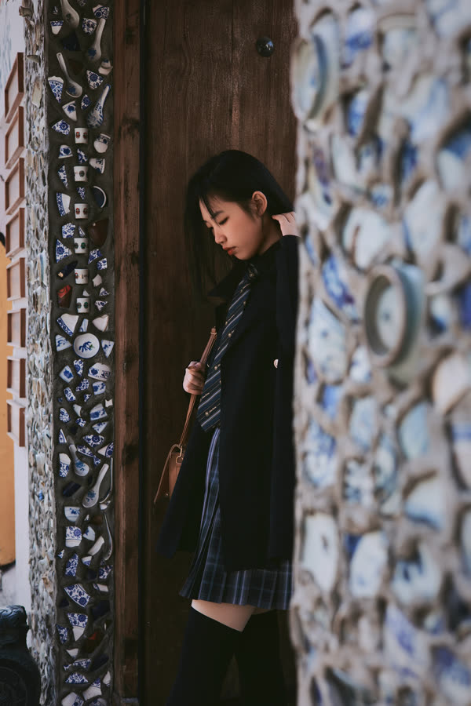

## 04 瓷片门 · 二【待审】
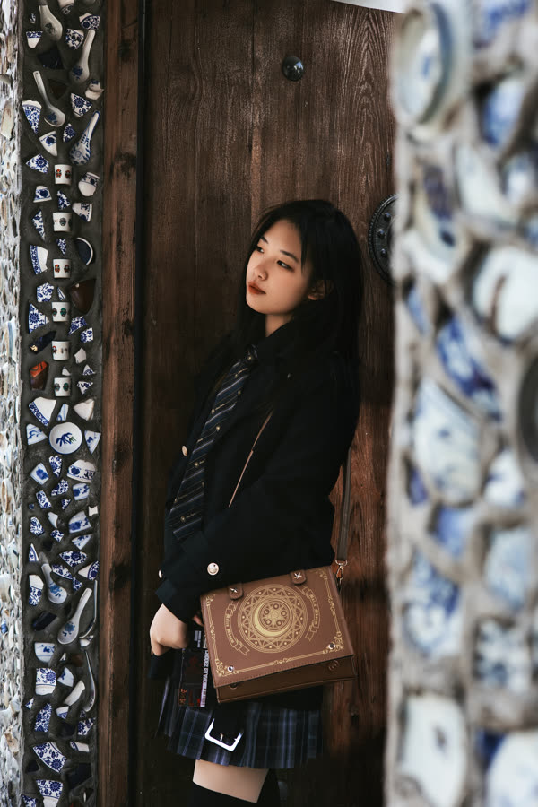

## 05 抱着书【待审】
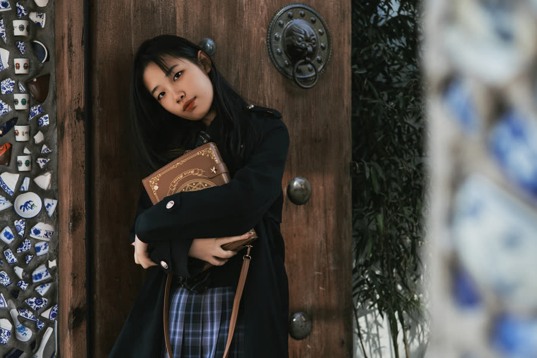
她抱着一只书本形状的包。那扇门很旧，门环还在。

## 06 靠门【待审】
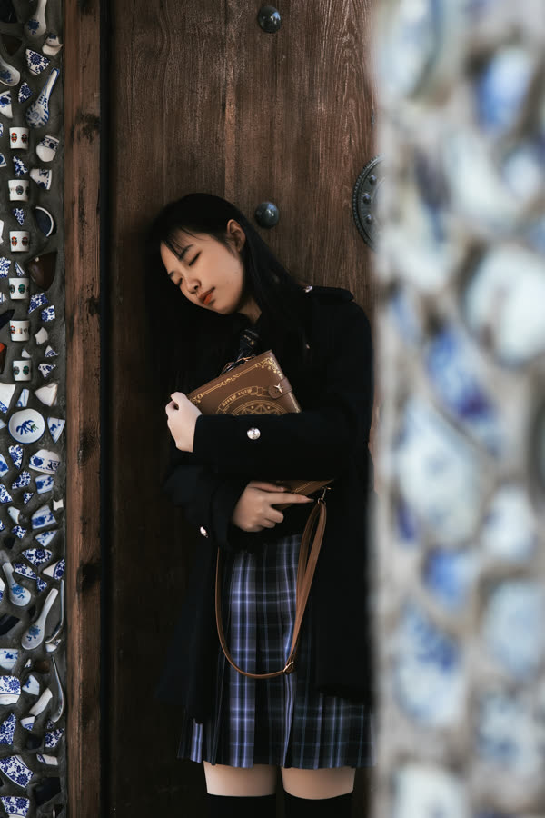
靠在木门上。两边的墙贴满了碎瓷片，青的、白的，一片挨着一片。

## 07 瓷片墙【待审】
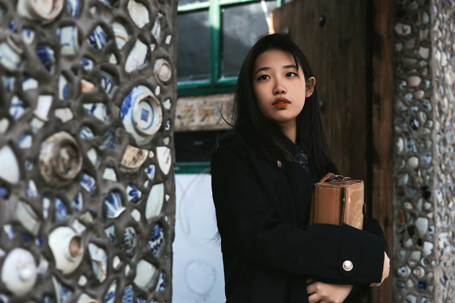
一整面墙的碎瓷片，在下午的光里一闪一闪。

## 08 红砖【待审】

趴在红砖墙上。墙头的花，冬天也还开着。

## 09 涂鸦墙【待审】
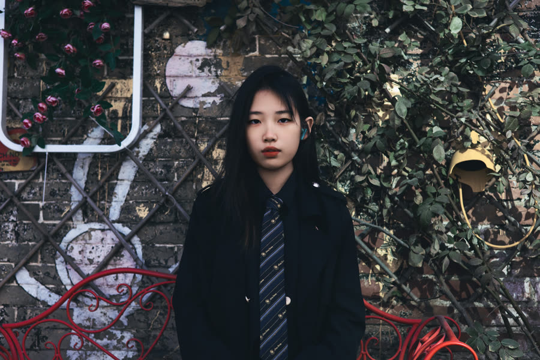

## 10 坐着【待审】
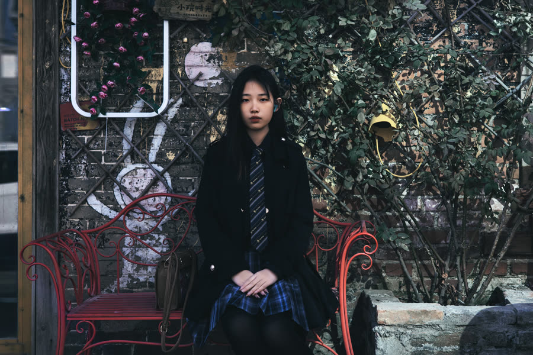

## 11 街口【待审】

走到街口，光从楼后面斜过来，把头发照成了浅色。

## 12 黑板【待审】
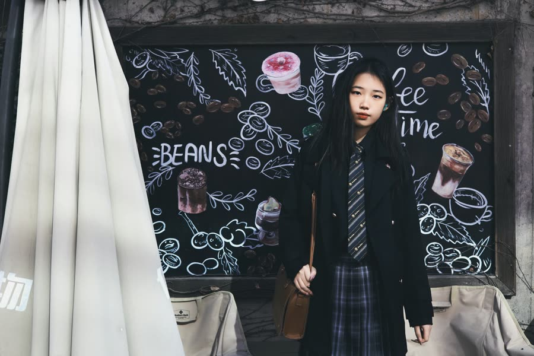
咖啡店的黑板上画满了粉笔画——咖啡豆、杯子，还有一行 coffee time。

## 13 黑板 · 二【待审】

## 14 黑板 · 三【待审】
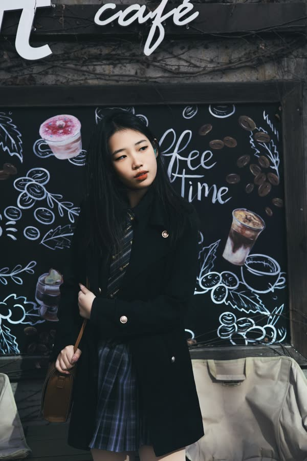

## 15 抬头【待审】
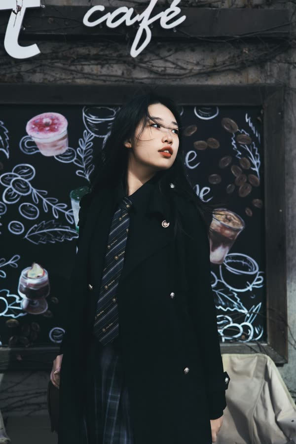

## 16 墙角【待审】
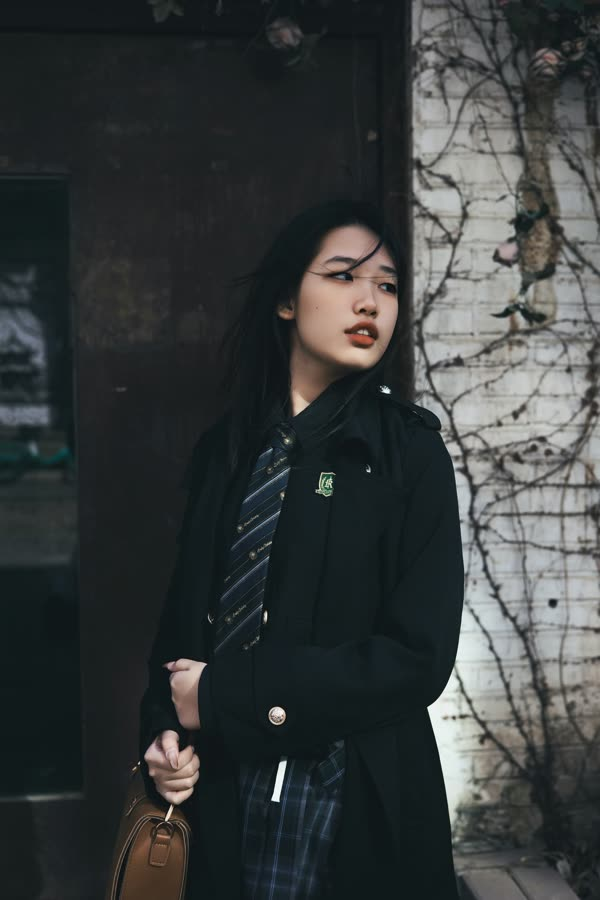
墙角爬着枯了的藤。她一直看着光来的地方。

## 17 书架前【待审】

进店歇了一会儿。书架、花瓶，一杯橙色的饮料。

## 18 楼梯下【待审】
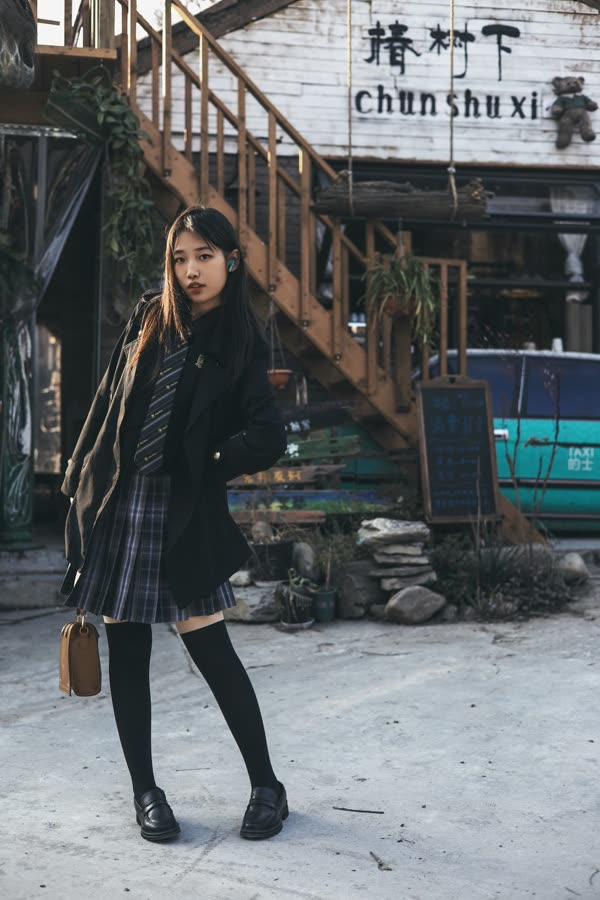

## 19 楼梯下 · 二【待审】
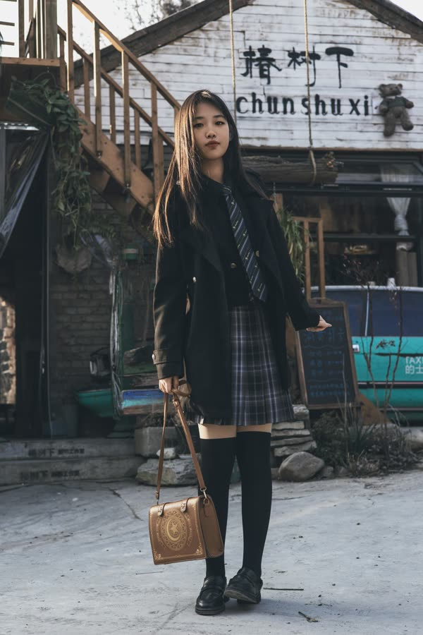

## 20 抬脚【待审】
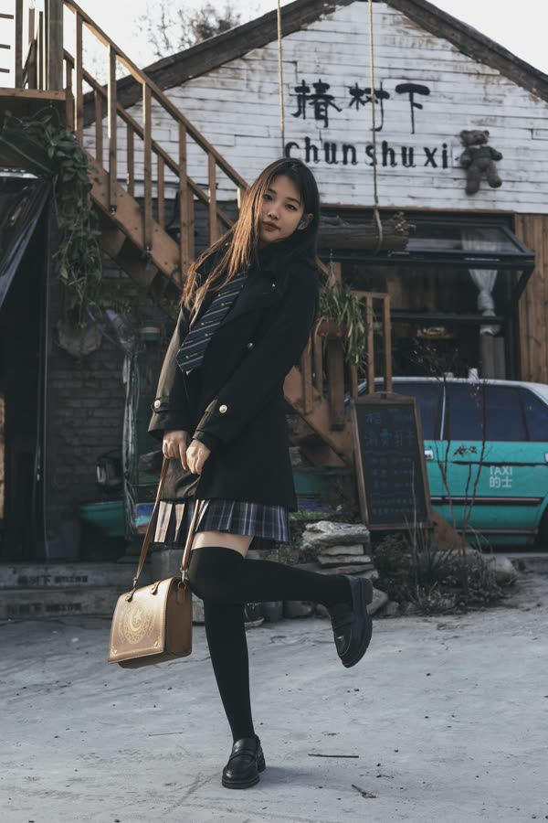

## 21 楼梯下 · 三【待审】
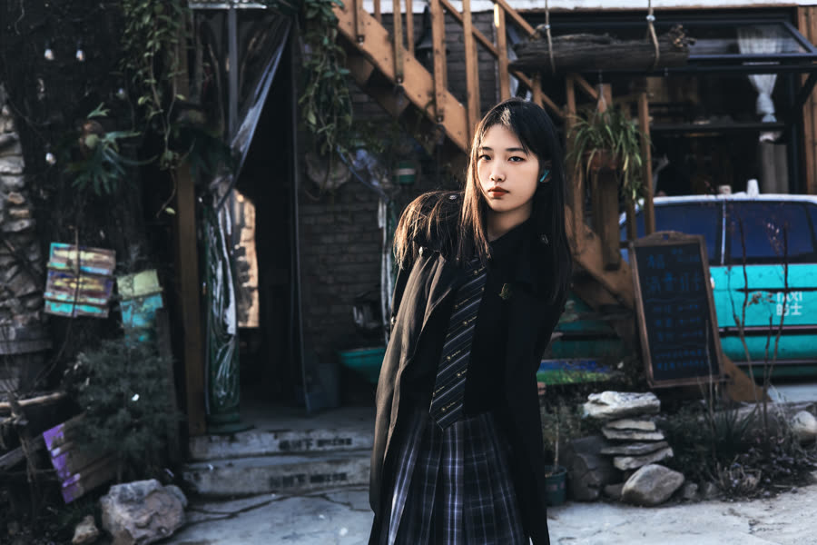
木楼梯从屋顶斜着下来，我们在它下面躲了一会儿太阳。

## 22 回头【待审】
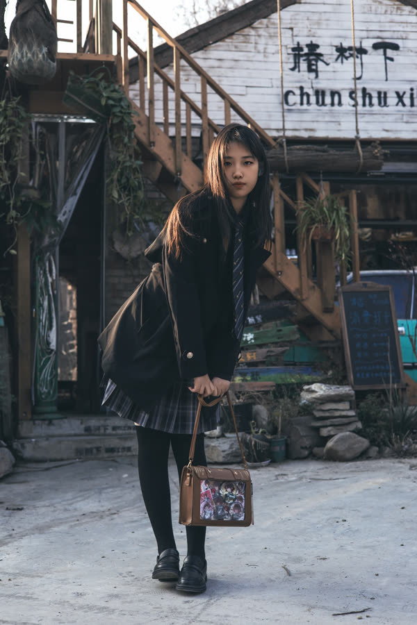

## 23 遮光【待审】
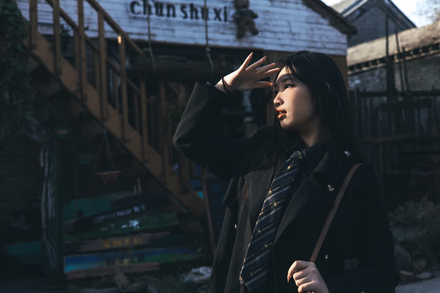

## 24 白墙【待审】

## 25 敬礼【待审】

最后在白墙前，她抬手挡了挡太阳，像敬了一个礼。
