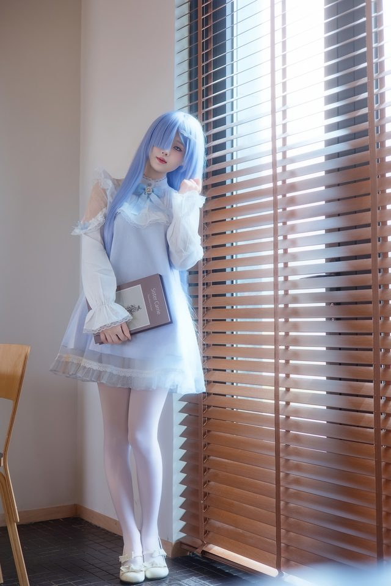

<!-- 饺椒·雷姆私设 · 文案 -->
> 改这一卷的文字：卷名、简介、正文，每张图的标题（## 那一行）和故事（图片下面那一段，可以不写）。
> 改完运行 node tools/build-series.mjs，再打开 proof.html 校对。

卷名：饺椒·雷姆私设
简介：
正文：

---

## 01

## 02

## 03

## 04

## 05

## 06

## 07

## 08

## 09

## 10

## 11

## 12

## 13

## 14

## 15

## 16

## 17

## 18

## 19

## 20

## 21

## 22

## 23

## 24

## 25

## 26

## 27

## 28

## 29

## 30

## 31

## 32

## 33

## 34

## 35

## 36

## 37

## 38

## 39

## 40

## 41

## 42

## 43

## 44

## 45

## 46

