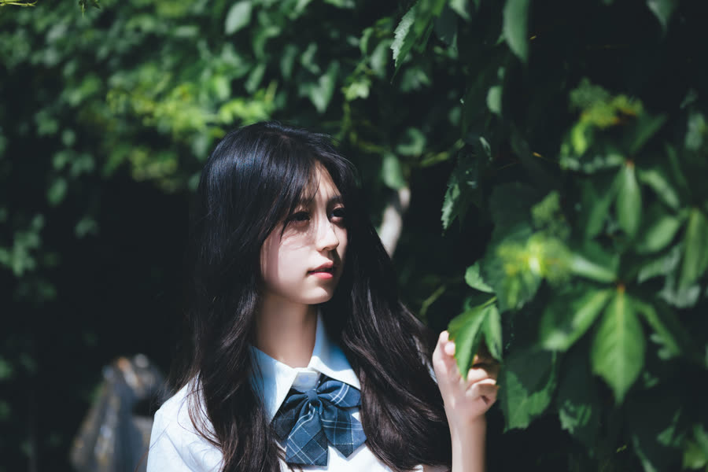
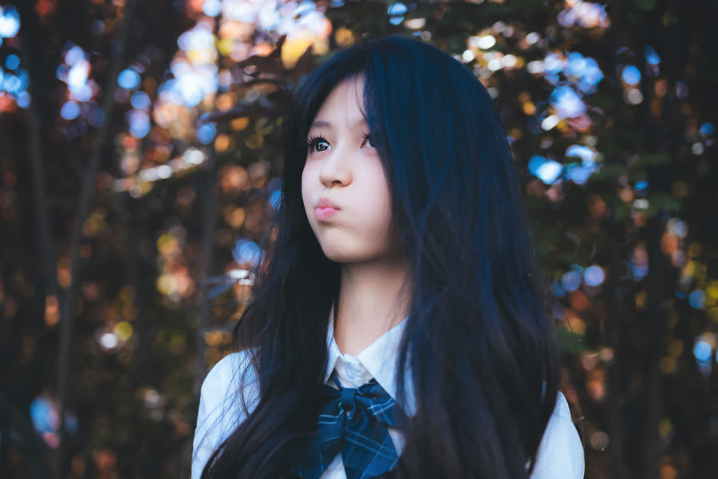
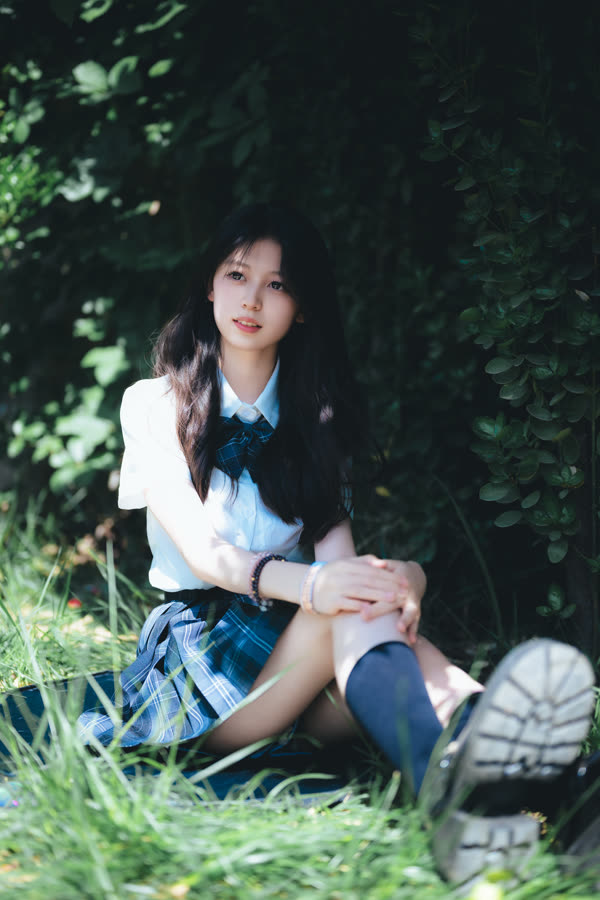

<!-- 五月的树荫 · 文案 -->
> 改这一卷的文字：卷名、简介、正文，每张图的标题（## 那一行）和故事（图片下面那一段，可以不写）。
> 【待审】表示还是代拟稿——写好或确认过，就把【待审】删掉。图片那一行不用动。
> 改完运行 node tools/build-series.mjs，再打开 proof.html 校对。

卷名：五月的树荫
简介【待审】：五月的一个下午，树荫很深，光从叶子的缝里漏下来。
正文【待审】：
我的记性不好，很多事过了一个夏天就想不起来了。

所以那天下午，我拍了很多张几乎一样的照片：同一片叶子，同一个手势，同一束从枝叶间漏下来的光。后来一张张翻看，才发现正是这些重复，让我记住了那一天。

---

## 01 躲在树后【待审】

藏在树干后面，只露出半张脸。

## 02 叶影【待审】

## 04 叶影 · 二【待审】

## 05 抬头【待审】

## 06 伸手【待审】

伸手去碰叶子，叶子比她的手还大。

## 07 紫叶【待审】

紫色的叶子，是那个下午唯一的暖色。

## 08 天空【待审】

抬头。叶子外面，天很蓝。

## 09 侧影【待审】

## 10 托腮【待审】

## 11 石边【待审】

## 13 藏【待审】

又藏起来了。

## 14 树干【待审】

## 15 剪刀手【待审】

## 16 遮光【待审】

## 17 草地【待审】

坐在草里，鞋带散着。

## 18 坐在草里【待审】

抱着膝盖坐下，草比想象中高。

## 19 嘘【待审】

## 20 嘘 · 二【待审】

## 22 冰饮【待审】

她拿着一杯冰饮，躲在叶子后面。
