<!-- 新一与毛利兰 · 文案 -->
> 改这一卷的文字：卷名、简介、正文，每张图的标题（## 那一行）和故事（图片下面那一段，可以不写）。
> 【待审】表示还是代拟稿——写好或确认过，就把【待审】删掉。图片那一行不用动。
> 改完运行 node tools/build-series.mjs，再打开 proof.html 校对。

卷名：新一与毛利兰
简介【待审】：一年的最后一天，下午两点四十分，光从窗户斜着照进来。
正文【待审】：
窗外的光很窄，只够照亮半张脸。我们就在那一小块光里，拍完了这一年。

后来换到楼梯间和教室，用很宽的画幅，把两个人放进同一个画面里。

---

## 01 背对背【待审】
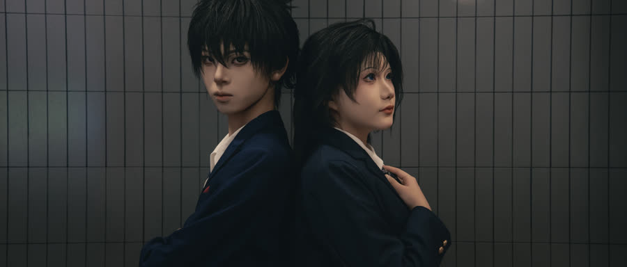
背对背，靠着同一面墙。

## 02 对望【待审】
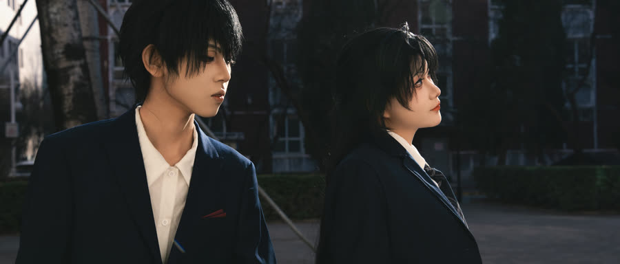
隔着一点距离，看向同一边。

## 03 楼梯间【待审】
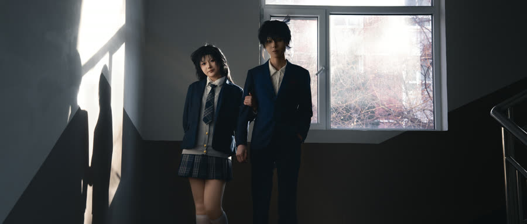
楼梯间只有一扇窗，那是唯一的光。

## 04 侧影【待审】
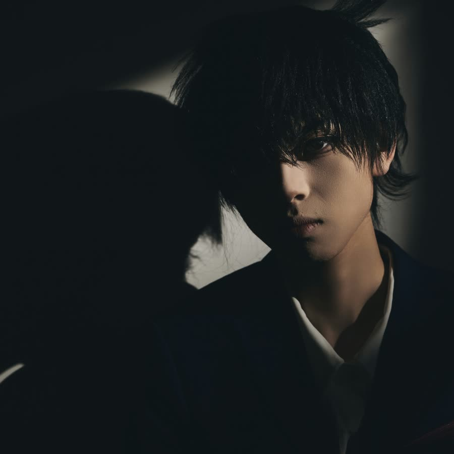

## 05 半张脸【待审】
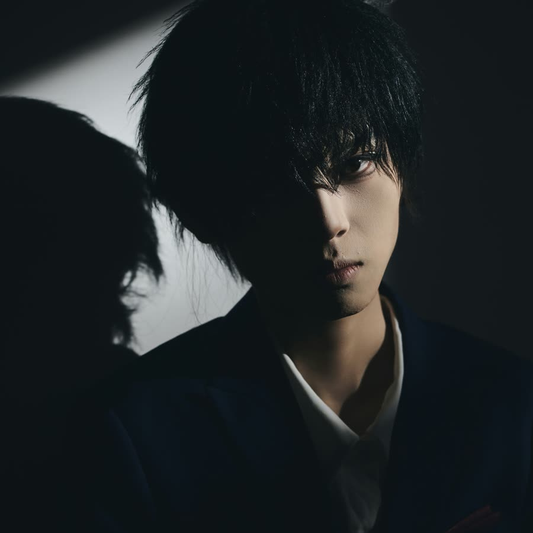

## 06 低头【待审】
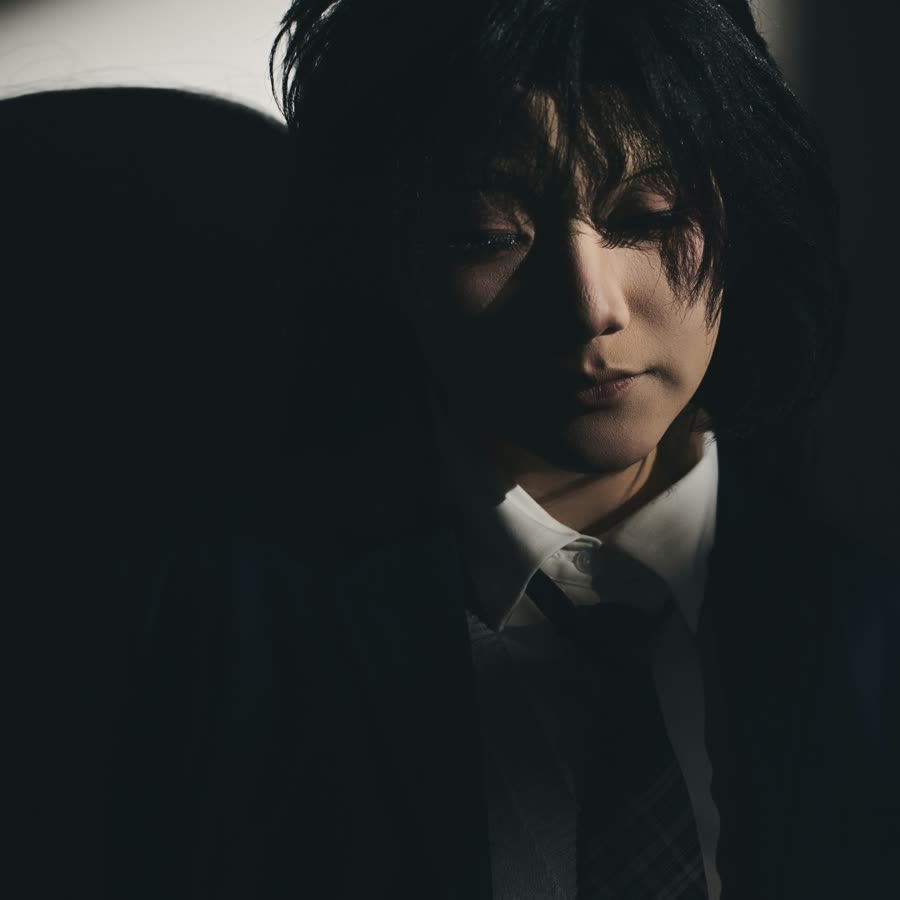

## 07 暗处【待审】
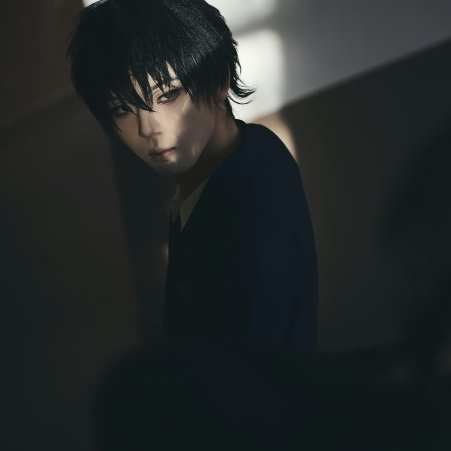

## 08 她【待审】
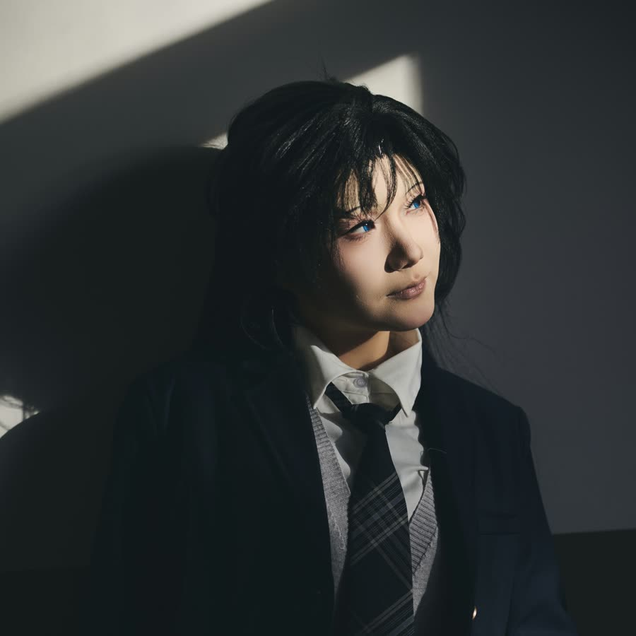
她的脸只有一半在光里，另一半留给了影子。

## 09 两个人【待审】
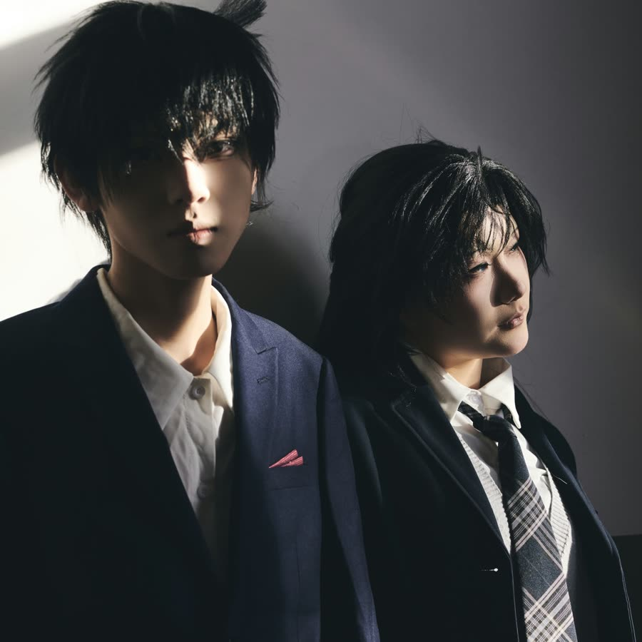
两个人，站进同一道光里。

## 10 光里【待审】
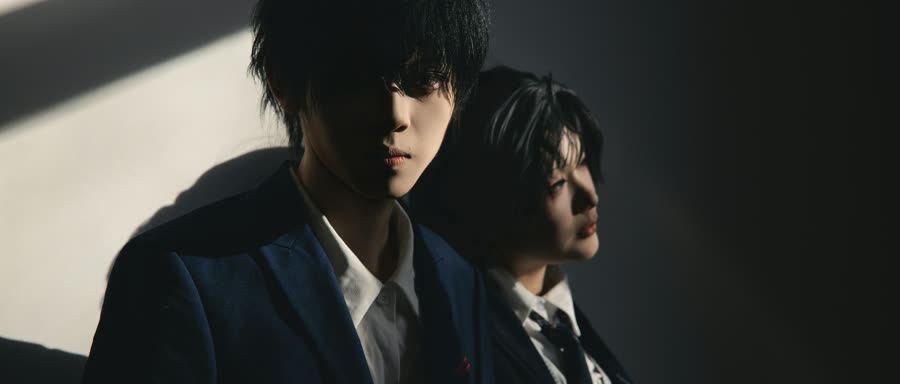
光从窗外斜进来，正好落在两个人中间。

## 11 粉色的墙【待审】
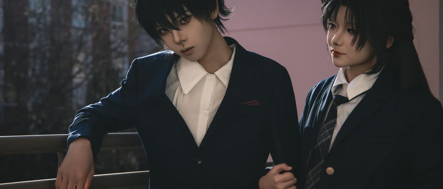

## 12 靠近【待审】
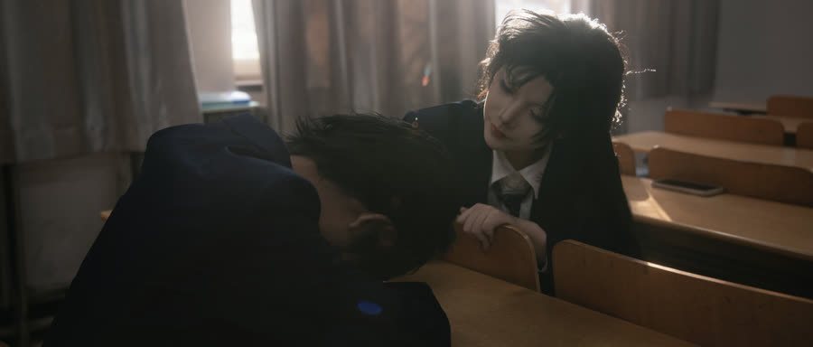

## 13 教室【待审】
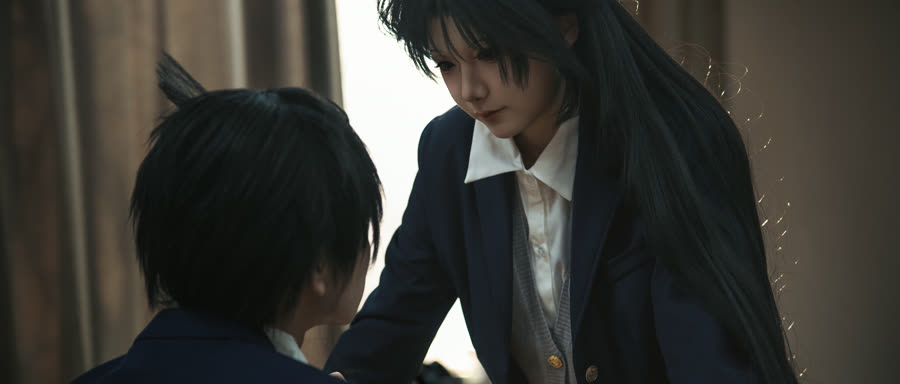
空教室，桌椅还没收。

## 14 翻书【待审】
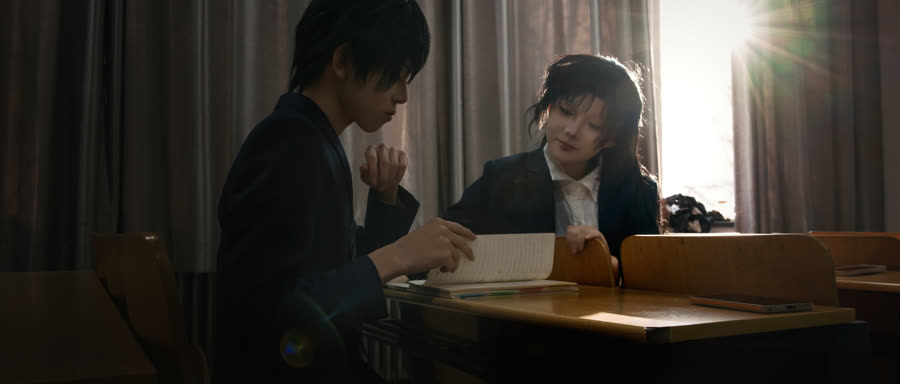

## 15 伸手【待审】
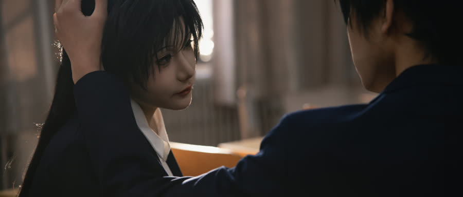
伸出手，像要碰到什么。
